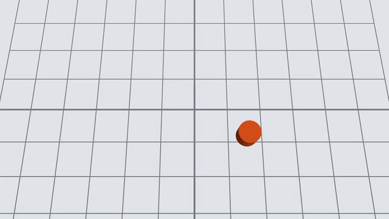
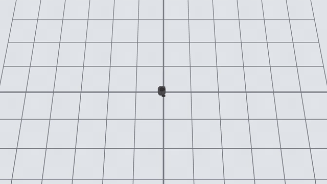
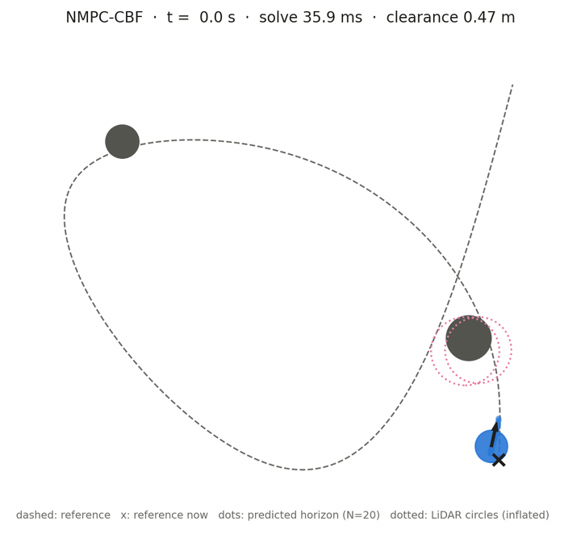
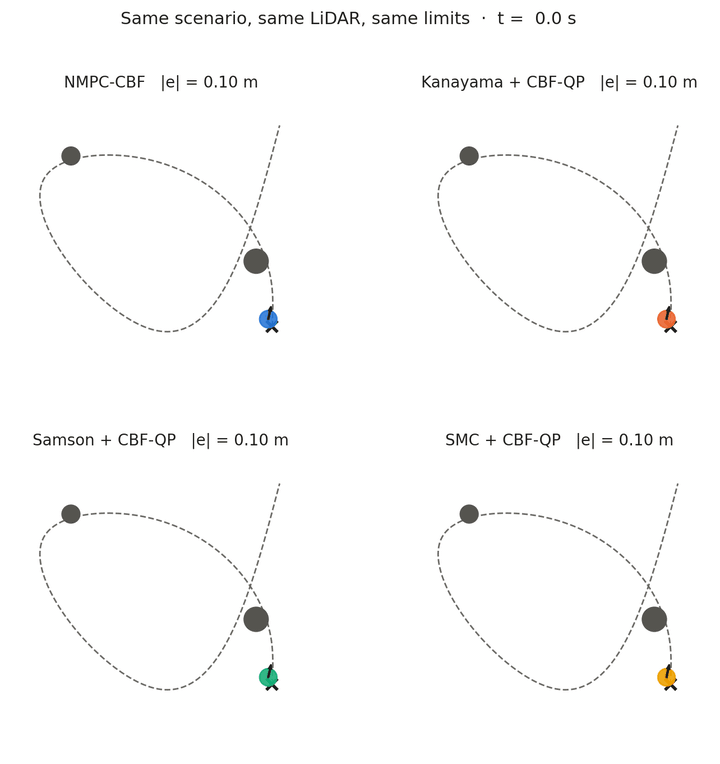
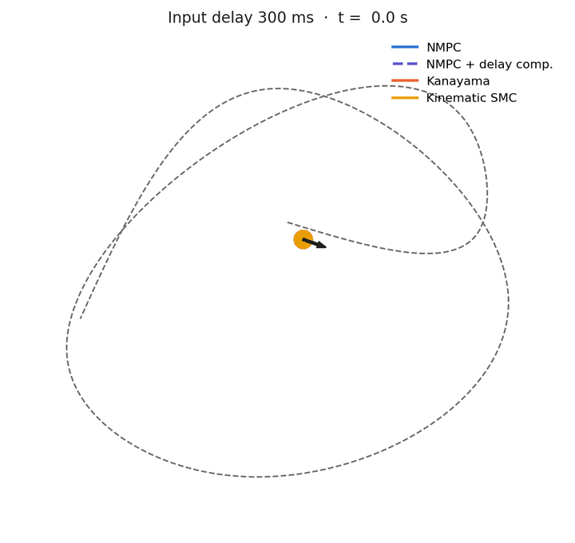
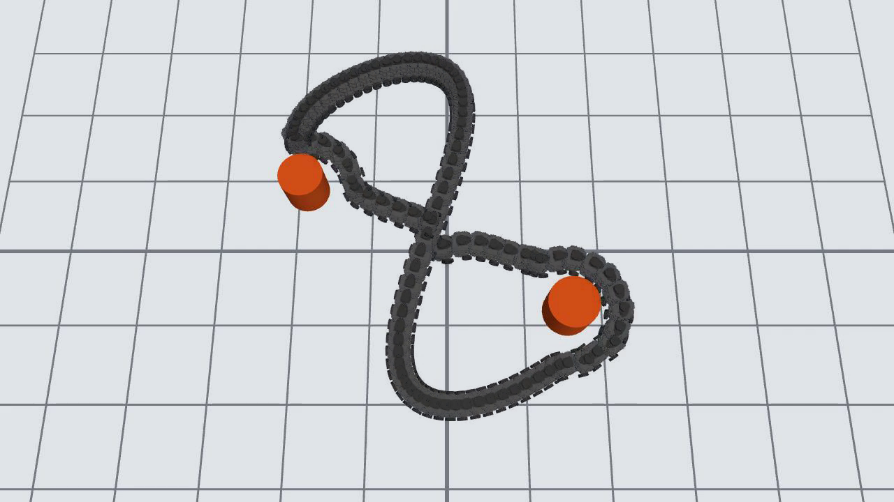
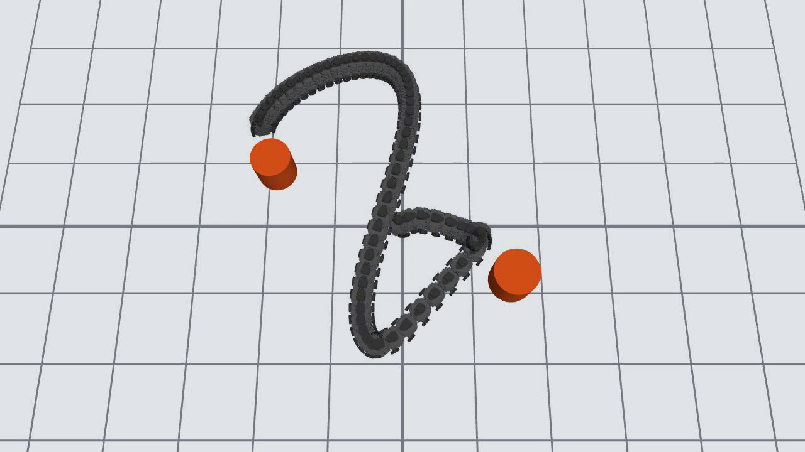

# NMPC trajectory tracking with obstacle avoidance — TurtleBot3 Burger

AR-521 *Control for Robotic Systems* end-semester project.

A nonlinear model predictive controller (CasADi + IPOPT, multiple shooting) tracks
reference trajectories on a TurtleBot3 Burger. It avoids LiDAR-detected obstacles
using control-barrier-function (CBF) constraints. The same code runs in a fast
Python simulator for Monte Carlo statistics, in Gazebo, and on the real robot. It
is benchmarked against three classical tracking controllers (Kanayama,
Samson/backstepping, sliding mode), all held to the same fairness rules.

| | |
|---|---|
| Robot | TurtleBot3 Burger (v ≤ 0.22 m/s, ω ≤ 2.84 rad/s, wheel limit \|v\| + 0.08\|ω\| ≤ 0.22) |
| Stack | Ubuntu 22.04 · ROS 2 Humble · Gazebo Classic 11 · Python 3.10 · CasADi ≥ 3.6 |
| Controllers | NMPC (none / DC / CBF / potential-field obstacle arms) · Kanayama · Samson ≡ kinematic backstepping · kinematic SMC · CBF-QP safety filter for baselines |
| Sensing | `/odom` (encoders + IMU heading) for state feedback · `/scan` → segmented circles → `/obstacles` |

## Demo

| Gazebo: NMPC-CBF, figure-8 with two obstacles (2× speed) | Gazebo: SMC + CBF-QP filter, same scenario (2× speed) |
|:---:|:---:|
|  |  |

| NMPC-CBF: predicted horizon and LiDAR-perceived (inflated) obstacles (3× speed) |
|:---:|
|  |

| Same scenario, same LiDAR, same limits: NMPC vs baselines + CBF-QP filter (3× speed) |
|:---:|
|  |

| 300 ms input delay: NMPC with/without delay compensation vs baselines (3× speed) |
|:---:|
|  |

"Long-exposure" composites of the two Gazebo runs (`experiments/trail_still.sh`):

| NMPC-CBF completes the figure-8 around both obstacles | SMC + CBF-QP stalls, cuts across, then stops at the second obstacle |
|:---:|:---:|
|  |  |

Full-resolution MP4s are in [media/](media/). The Gazebo clips are regenerated
by `experiments/record_gazebo.sh` and the plots by `experiments/make_animations.py`.

## Results at a glance

These come from the kinematic simulator, with 30 paired seeds per cell. Full
tables are in [results/tables/](results/tables/) and figures in
[results/figures/](results/figures/).

| Question | Finding |
|---|---|
| Obstacle avoidance | **NMPC (CBF, DC or PF constraints): 100% success, 0 collisions** in 60 LiDAR-perceived scenarios. The baselines behind a CBF-QP filter never collide either, but they **deadlock in 43–100%** of runs. |
| Obstacle-free tracking | NMPC is significantly best (paired Wilcoxon test, Holm-corrected) on references with varying curvature or stops: Lissajous, random splines and point-to-point. Kanayama wins on the circle and SMC on the figure-8. Every controller is accurate to well under 1 mm. |
| Input delay | Delay is the dominant failure mode for every controller. **NMPC with delay compensation stays at 0.2 mm RMSE up to 400 ms**, while everything else degrades by about 1000×. |
| Model mismatch and noise | NMPC degrades *faster* than the classical laws under asymmetric wheel-radius error and pose noise. SMC is the most robust to wheel asymmetry. |
| Computation | Warm-started IPOPT at N = 20 with obstacle constraints takes 10 ms median and 21 ms p99, with **0 missed 100 ms deadlines**. |
| CBF γ ablation | Smaller γ keeps a larger margin. At γ = 1 the CBF reduces to the distance constraint, as theory predicts. |

## Repository layout

```
EndSemProject/
├── PLAN.md                     intent, architecture, 14-day schedule, hardware checklist
├── reports/                    design research report (sources for every decision)
├── research_notes/             raw research notes behind the report
├── ros2_ws/src/tb3_mpc/        ROS 2 ament_python package
│   ├── tb3_mpc/core/           ROS-free, unit-tested core
│   │   ├── model.py              unicycle, RK4, saturation (box + wheel diamond + rate)
│   │   ├── references.py         flatness-based references: circle, figure-8, sinusoid,
│   │   │                         Lissajous, random splines, point-to-point
│   │   ├── controllers.py        Kanayama, Samson/backstepping, kinematic SMC
│   │   ├── nmpc.py               NMPC (multiple shooting, IPOPT, warm start, fallback)
│   │   ├── safety_filter.py      CBF-QP filter (OSQP) for the baselines
│   │   ├── lidar.py              scan → adaptive-breakpoint segments → circle fits
│   │   ├── scenarios.py          seeded scenarios + SE(2) frame helpers
│   │   ├── simulator.py          kinematic plant with delay / lag / wheel error / noise
│   │   └── metrics.py            tracking, effort, constraint, safety, compute metrics
│   ├── tb3_mpc/nodes/          thin rclpy nodes
│   │   ├── tracking_controller.py   10 Hz control loop, watchdogs, delay compensation, CSV log
│   │   ├── obstacle_extractor.py    /scan → /obstacles (odom frame, tf2 at scan stamp)
│   │   ├── cmd_vel_relay.py         on-robot timeout relay (runs on the Pi)
│   │   └── obstacle_spawner.py      Gazebo cylinders for a scenario + ground truth
│   ├── launch/                 sim / real (laptop) / robot (Pi)
│   ├── config/tb3_mpc.yaml     all parameters (frozen tuned gains)
│   ├── rviz/tb3_mpc.rviz
│   └── test/test_core.py       29 unit + closed-loop tests
├── experiments/
│   ├── tune_controllers.py     equal-budget gain tuning on held-out seeds
│   ├── run_benchmark.py        paired Monte Carlo suites (multiprocess)
│   ├── analyze.py              tables, Wilcoxon/Holm stats, report figures
│   ├── hw_step_test.py         hardware step test: dead time, lag, sensor rates
│   ├── make_animations.py      data-driven MP4/GIF animations
│   ├── record_gazebo.sh        Gazebo scene-camera recording -> MP4/GIF
│   └── trail_still.sh          long-exposure still from a recording
├── media/                      demo GIFs and MP4s
├── report/                     LaTeX report (main.tex, refs.bib, tables/, figures/)
└── results/                    generated CSVs, traces, tables, figures
```

## Setup

```bash
sudo apt install ros-humble-turtlebot3-gazebo ros-humble-turtlebot3-description   # if missing
pip install --user "casadi>=3.6" pandas scipy matplotlib tabulate pytest
```

**Build.** colcon's generated setup scripts break on paths that contain spaces
(this project lives under `.../Aug26-7th Sem/...`). Build in a space-free
workspace that symlinks the package:

```bash
mkdir -p ~/ar521_ws/src
ln -sfn "$PWD/ros2_ws/src/tb3_mpc" ~/ar521_ws/src/tb3_mpc
cd ~/ar521_ws && source /opt/ros/humble/setup.bash
colcon build --symlink-install && source install/setup.bash
```

## Tests

```bash
cd ros2_ws/src/tb3_mpc && python3 -m pytest test/ -q     # ~35 s
```

## Tier 1 — Monte Carlo in the kinematic simulator

```bash
python3 experiments/tune_controllers.py --seeds 8 --workers 12      # freezes results/tuned_gains.json
python3 experiments/run_benchmark.py --suite all --seeds 30 --workers 12
python3 experiments/analyze.py                                      # results/tables, results/figures
```

Each controller gets the same seed, which fixes the reference, initial offset,
noise and obstacles. The suites are `tracking`, `robustness` (delay, noise,
wheel mismatch, offsets), `obstacles`, `horizon`, `gamma` (DC vs CBF γ vs PF)
and `timing` (run serially so solve times are honest).

## Tier 2 — Gazebo

```bash
ros2 launch tb3_mpc sim.launch.py controller:=nmpc \
    reference:='{"type": "figure8"}' ref_offset:='0.15,-0.1,0.3' obstacle_seed:=3
# baselines with the CBF-QP safety filter:
ros2 launch tb3_mpc sim.launch.py controller:=smc safety_filter:=true obstacle_seed:=3
# batch / headless:
ros2 launch tb3_mpc sim.launch.py gui:=false rviz:=false exit_on_finish:=true run_name:=fig8_nmpc
```

The launch file patches the stock Burger model at start-up:

- `/odom` comes from the wheel encoders, so it drifts like the real robot.
- A p3d plugin publishes the true pose on `/ground_truth`.

Logs are written to `~/tb3_mpc_logs/sim/*.csv`.

Reference specs (JSON) are `circle`, `figure8`, `sinusoid`, `lissajous`,
`random_spline` (with `"seed"`), and `point_to_point` (with `"start"` and
`"goal"`, given in the reference frame). `ref_offset` sets where the robot
starts relative to the start of the reference.

## Tier 3 — Real TurtleBot3

On the robot (Pi), start this **first**:

```bash
export TURTLEBOT3_MODEL=burger LDS_MODEL=LDS-02 ROS_DOMAIN_ID=<unique>
ros2 topic info -v /cmd_vel                       # Twist or TwistStamped?
ros2 launch tb3_mpc robot.launch.py out_stamped:=false
```

Then on the laptop:

```bash
ros2 launch tb3_mpc real.launch.py controller:=nmpc reference:='{"type": "figure8", "a": 0.8}'
ros2 topic pub --once /estop std_msgs/msg/Bool "{data: true}"     # emergency stop
```

Work through the hardware checklist in [PLAN.md](PLAN.md) before the first run:
chrony, multicast, the `cmd_vel` message type, the latency step test and the
relay timeout test.

## Design notes (for the report and viva)

- **Model.** The state is (x, y, θ) and the input is (v, ω). The plan is discretized with RK4 at Δt = 0.1 s over N = 20 steps (2 s look-ahead).
- **Cost.**
  - Position error is weighted directly.
  - Heading error uses 2(1 − cos Δθ), which avoids angle wrap-around.
  - The penalty is on u − u_ref, so the controller doesn't fight the feedforward.
  - A Δu term keeps commands smooth.
  - A terminal cost of 10Q is included. There is no terminal set; the report should state this gap from the Gu & Hu stability theory.
- **Constraints.**
  - Box limits on v and ω.
  - The wheel-speed diamond |v| + 0.08|ω| ≤ 0.22, which is the limit that actually binds.
  - Rate limits.
  - Obstacles as discrete-time CBF constraints h(x_{k+1}) ≥ (1−γ)h(x_k) − s, evaluated at a look-ahead point so heading enters h. The slack s has an exact L1 penalty.
- **Solver.**
  - CasADi `nlpsol`/IPOPT, with the problem built once.
  - Obstacles are a fixed-size parameter block, filled with far-away dummies when unused.
  - Each solve warm-starts from the shifted previous solution and its duals.
  - A wall-time cap and fallback (previous plan, then brake) handle failed solves.
- **Fairness.**
  - Every controller goes through the same saturation, rate, state estimate and tuning budget.
  - In obstacle runs, baselines get the same CBF constraint as a QP filter.
  - Kinematic backstepping and the Samson law are the same controller, so they count as one baseline.
